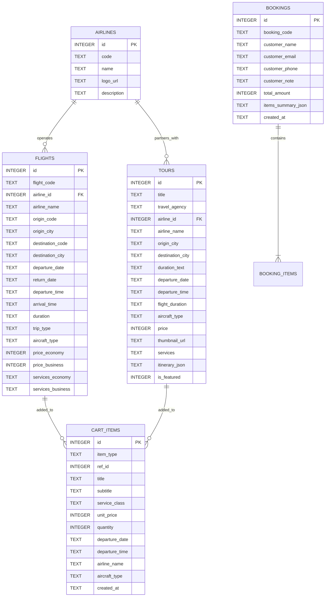

# Thiết kế Cơ sở Dữ liệu SQLite & Kiến trúc Kỹ thuật (`DATABASE.md`)

## 1. Giải pháp SQLite trên Frontend (Không dùng Backend)
Vì dự án yêu cầu **HTML, CSS, JavaScript thuần, không có backend** nhưng sử dụng **Database: SQLite**, kiến trúc sẽ sử dụng **`sql.js`** (bản biên dịch SQLite chính thức sang WebAssembly chạy trực tiếp trong trình duyệt):

1. **Khởi tạo**: Tải thư viện `sql-wasm.js` qua CDN (`https://cdnjs.cloudflare.com/ajax/libs/sql.js/1.10.3/sql-wasm.js`).
2. **Lưu trữ bền vững (Persistence)**:
   - Lần đầu truy cập: Thực thi script DDL & Seed Data để tạo các bảng `airlines`, `flights`, `tours`, `cart_items`, `bookings`.
   - Sau mỗi câu lệnh `INSERT`, `UPDATE`, `DELETE` (ví dụ khi thêm/xóa giỏ hàng hoặc tạo đơn đăng ký), xuất binary của SQLite (`db.export()`) sang chuỗi Base64 và lưu vào `localStorage.setItem('vietjet_sqlite_db', ...)`.
   - Khi chuyển sang trang HTML khác, `js/db.js` tự động nạp lại database từ `localStorage`, đảm bảo dữ liệu SQLite giữ nguyên 100% giữa các trang.

---

## 2. Sơ đồ Quan hệ Thực thể (ERD)



---

## 3. Mã nguồn SQL Schema (`schema.sql`)

```sql
-- 1. Bảng Hãng hàng không (Airlines)
CREATE TABLE IF NOT EXISTS airlines (
    id INTEGER PRIMARY KEY AUTOINCREMENT,
    code TEXT NOT NULL UNIQUE,
    name TEXT NOT NULL,
    logo_url TEXT NOT NULL,
    country TEXT DEFAULT 'Việt Nam'
);

-- 2. Bảng Chuyến bay (Flights)
CREATE TABLE IF NOT EXISTS flights (
    id INTEGER PRIMARY KEY AUTOINCREMENT,
    flight_code TEXT NOT NULL,
    airline_id INTEGER NOT NULL,
    airline_name TEXT NOT NULL,
    origin_code TEXT NOT NULL,
    origin_city TEXT NOT NULL,
    destination_code TEXT NOT NULL,
    destination_city TEXT NOT NULL,
    departure_date TEXT NOT NULL,        -- YYYY-MM-DD
    return_date TEXT,                    -- YYYY-MM-DD (nếu khứ hồi)
    departure_time TEXT NOT NULL,        -- HH:mm (VD: 08:30)
    arrival_time TEXT NOT NULL,          -- HH:mm (VD: 10:35)
    duration TEXT NOT NULL,              -- VD: 2 giờ 05 phút
    trip_type TEXT NOT NULL,             -- 'one-way', 'round-trip', 'direct', 'multi-city'
    is_direct INTEGER DEFAULT 1,         -- 1: Bay thẳng, 0: Nối chuyến
    aircraft_type TEXT NOT NULL,         -- VD: Airbus A321neo, Boeing 787-9 Dreamliner
    price_economy INTEGER NOT NULL,      -- Giá hạng Phổ thông (VNĐ)
    price_business INTEGER NOT NULL,     -- Giá hạng Thương gia (VNĐ)
    services_economy TEXT NOT NULL,      -- Dịch vụ hạng phổ thông
    services_business TEXT NOT NULL,     -- Dịch vụ hạng thương gia
    FOREIGN KEY (airline_id) REFERENCES airlines(id)
);

-- 3. Bảng Tour du lịch (Tours)
CREATE TABLE IF NOT EXISTS tours (
    id INTEGER PRIMARY KEY AUTOINCREMENT,
    title TEXT NOT NULL,
    travel_agency TEXT NOT NULL,         -- Hãng du lịch: Vietjet Holidays, Vietravel, Saigontourist...
    airline_id INTEGER NOT NULL,
    airline_name TEXT NOT NULL,          -- Hãng hàng không vận chuyển
    origin_city TEXT NOT NULL,           -- Điểm đi
    destination_city TEXT NOT NULL,      -- Điểm đến
    duration_text TEXT NOT NULL,         -- Số ngày/đêm (VD: 3 Ngày 2 Đêm)
    departure_date TEXT NOT NULL,        -- Ngày cất cánh (YYYY-MM-DD)
    departure_time TEXT NOT NULL,        -- Thời gian cất cánh (HH:mm)
    flight_duration TEXT NOT NULL,       -- Thời gian bay (VD: 1 giờ 50 phút)
    aircraft_type TEXT NOT NULL,         -- Loại máy bay (Boeing, Airbus...)
    price INTEGER NOT NULL,              -- Giá tour (VNĐ)
    thumbnail_url TEXT NOT NULL,         -- Hình thumbnail 600x400
    services TEXT NOT NULL,              -- Dịch vụ bao gồm (Khách sạn, vé máy bay, ăn uống...)
    itinerary_json TEXT NOT NULL,        -- JSON mảng lịch trình chi tiết từng ngày
    is_featured INTEGER DEFAULT 1,       -- 1: Hiển thị ở 8 tour nổi bật trang chủ
    FOREIGN KEY (airline_id) REFERENCES airlines(id)
);

-- 4. Bảng Giỏ hàng (Cart Items)
CREATE TABLE IF NOT EXISTS cart_items (
    id INTEGER PRIMARY KEY AUTOINCREMENT,
    item_type TEXT NOT NULL,             -- 'FLIGHT' hoặc 'TOUR'
    ref_id INTEGER NOT NULL,             -- ID của flight hoặc tour
    title TEXT NOT NULL,                 -- Tên chuyến bay (SGN -> HAN) hoặc Tên Tour
    subtitle TEXT,                       -- Chi tiết phụ (Mã chuyến bay / Hãng du lịch)
    service_class TEXT,                  -- 'Hạng Phổ Thông' | 'Hạng Thương Gia' | 'Trọn gói Tour'
    unit_price INTEGER NOT NULL,
    quantity INTEGER DEFAULT 1,
    departure_date TEXT,
    departure_time TEXT,
    airline_name TEXT,
    aircraft_type TEXT,
    created_at TEXT DEFAULT CURRENT_TIMESTAMP
);

-- 5. Bảng Đơn đặt chỗ (Bookings)
CREATE TABLE IF NOT EXISTS bookings (
    id INTEGER PRIMARY KEY AUTOINCREMENT,
    booking_code TEXT NOT NULL UNIQUE,   -- Mã đặt chỗ (VD: VJ-20261107-889)
    customer_name TEXT NOT NULL,
    customer_email TEXT NOT NULL,
    customer_phone TEXT NOT NULL,
    customer_note TEXT,
    total_amount INTEGER NOT NULL,
    items_summary_json TEXT NOT NULL,
    created_at TEXT DEFAULT CURRENT_TIMESTAMP
);
```

---

## 4. Các Truy vấn SQL cho Bộ Lọc (Filter Queries)

### 4.1. Bộ lọc Trang Chuyến Bay (`flights.html`)
```sql
SELECT * FROM flights
WHERE 1=1
  -- Lọc theo điểm đi & điểm đến (nếu có)
  AND (:origin IS NULL OR origin_code = :origin)
  AND (:destination IS NULL OR destination_code = :destination)
  -- Lọc theo loại vé: khứ hồi ('round-trip'), một chiều ('one-way'), bay thẳng ('direct'), nhiều thành phố ('multi-city')
  AND (:trip_type IS NULL OR trip_type = :trip_type OR (:trip_type = 'direct' AND is_direct = 1))
  -- Lọc theo hãng hàng không
  AND (:airline_name IS NULL OR airline_name IN (...))
  -- Lọc theo khung giờ cất cánh (VD: 06:00 đến 12:00)
  AND (departure_time >= :min_hour AND departure_time < :max_hour)
ORDER BY
  CASE WHEN :sort_by = 'price_asc' THEN price_economy END ASC,
  CASE WHEN :sort_by = 'price_desc' THEN price_economy END DESC;
```

### 4.2. Bộ lọc Trang Tour (`tours.html`)
```sql
SELECT * FROM tours
WHERE 1=1
  -- Lọc theo hãng hàng không
  AND (:airline_name IS NULL OR airline_name IN (...))
  -- Lọc theo giờ cất cánh
  AND (departure_time >= :min_hour AND departure_time < :max_hour)
ORDER BY
  CASE WHEN :sort_by = 'price_asc' THEN price END ASC,
  CASE WHEN :sort_by = 'price_desc' THEN price END DESC;
```

---

## 5. Cấu hình Gửi Email Xác nhận (`minhkhoithan@gmail.com`)

Vì ứng dụng không sử dụng Backend, luồng gửi email từ **`minhkhoithan@gmail.com`** đến email của khách hàng được thiết kế theo cơ chế **EmailJS REST API** (kèm chế độ Fallback giả lập thông minh nếu chưa điền Public Key):

1. **Tích hợp EmailJS (`js/email.js`)**:
   - Kết nối Gmail Service của tài khoản **`minhkhoithan@gmail.com`** trên EmailJS.
   - Truyền `template_params` gồm:
     - `from_email`: `"minhkhoithan@gmail.com"`
     - `from_name`: `"Vietjet Air Travel"`
     - `to_email`: Email khách hàng nhập trong form Giỏ Hàng
     - `to_name`: Họ tên khách hàng
     - `booking_code`: Mã đơn hàng vừa sinh
     - `order_details`: Bảng chi tiết các chuyến bay / tour đã đăng ký
     - `total_price`: Tổng tiền thanh toán
2. **Trải nghiệm mượt mà**:
   - Ngay khi bấm **Đăng Ký**, hệ thống gửi request tới EmailJS API, đồng thời hiển thị Modal xác nhận hoàn tất có ghi rõ:
     > *"Đăng ký hoàn thành! Một email xác nhận đặt chỗ đã được gửi từ **minhkhoithan@gmail.com** đến địa chỉ **[email_khach_hang]** của quý khách."*
