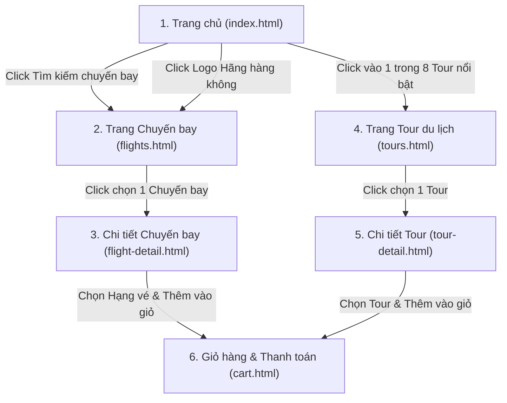

# Đặc tả Yêu cầu Sản phẩm (PRD) — Website Du lịch & Hàng không Vietjet

## 1. Giới thiệu tổng quan
Website **Vietjet** là nền tảng thương mại điện tử lĩnh vực du lịch và hàng không, cho phép khách hàng tra cứu chuyến bay, khám phá các tour du lịch trọn gói, chọn hạng vé (Phổ thông / Thương gia), quản lý giỏ hàng và đăng ký đặt chỗ nhận email xác nhận trực tiếp.

- **Tên thương hiệu**: Vietjet
- **Màu sắc chủ đạo**: Nền trắng (`#FFFFFF`), tông sáng, màu chủ đạo Đỏ (`#ee1d23`).
- **Kiến trúc**: 100% Frontend (HTML, CSS, JS thuần) kết hợp cơ sở dữ liệu **SQLite** (qua `sql.js` WebAssembly).

---

## 2. Cấu trúc các Trang & Luồng Nghiệp vụ (6 Trang Chính)

---

## 3. Chi tiết Chức năng Từng Trang

### 3.1. Header & Footer (Dùng chung cho toàn bộ trang)
- **Header**:
  - Logo Vietjet (`images/2aOboRAvPCnNF8ux8l12JJoKC6uw9yMZkM5dUYs4.jpg`) dẫn về Trang chủ.
  - Menu điều hướng: **Trang chủ**, **Chuyến bay**, **Tour du lịch**, **Giỏ hàng** (kèm badge hiển thị số lượng item đang có trong giỏ).
- **Footer**:
  - Thông tin liên hệ, tổng đài, email hỗ trợ (`minhkhoithan@gmail.com`), bản quyền thương hiệu Vietjet.

---

### 3.2. Trang chủ (`index.html`)
1. **Hero Banner & Khung Tìm kiếm Chuyến bay**:
   - Hình nền/banner sáng sủa với hình ảnh tiếp viên và tàu bay Vietjet (`images/2aOboRAvPChFky1ocMfEck7L9rvvV1VWvb6HTuOe.jpg`).
   - **Loại vé (Radio/Tabs)**: Vé khứ hồi (`round-trip`), Vé một chiều (`one-way`).
   - **Điểm xuất phát (Dropdown/Select)**: TP. Hồ Chí Minh (SGN), Hà Nội (HAN), Đà Nẵng (DAD), Phú Quốc (PQC), Nha Trang (CXR), Singapore (SIN), Bangkok (BKK), Tokyo (NRT), Seoul (ICN)...
   - **Điểm đến (Dropdown/Select)**: Danh sách các sân bay/thành phố tương ứng.
   - **Chọn ngày**: Ngày đi (Datepicker) và Ngày về (ẩn/vô hiệu hóa nếu chọn Vé một chiều).
   - **Nút "Tìm Kiếm"** (`#ee1d23`): Khi click sẽ chuyển hướng sang trang `flights.html` kèm theo tham số lọc trên URL.

2. **Phần Tour Du Lịch Nổi Bật (8 Tours)**:
   - Hiển thị lưới (Grid 4 cột trên Desktop, 2 cột trên Tablet, 1 cột trên Mobile) gồm đúng **8 tour du lịch nổi bật**.
   - Mỗi thẻ Tour (Card) bao gồm:
     - **Hình thumbnail**: Kích thước chuẩn tỷ lệ **600x400** (`aspect-ratio: 3/2`, `width: 600px`, `height: 400px` hoặc responsive giữ đúng tỷ lệ 600x400).
     - **Tên tour** (VD: *Khám phá Đảo Ngọc Phú Quốc*, *Hành trình Đà Nẵng - Hội An - Bà Nà Hills*...).
     - **Hãng du lịch / Hãng bay đồng hành** (VD: Vietjet Holidays, Vietravel, Saigontourist...).
     - **Số ngày/đêm** (VD: `3 Ngày 2 Đêm`, `4 Ngày 3 Đêm`).
     - **Giá tour** nổi bật màu đỏ `#ee1d23` (VD: `3.990.000 ₫`).
   - **Sự kiện Click**: Click vào thẻ tour dẫn đến trang **Tour** (`tours.html` hoặc `tour-detail.html` tùy ngữ cảnh người dùng click nút Xem tất cả / Xem chi tiết). *Lưu ý: Theo yêu cầu đề bài, click vào thẻ tour ở Trang chủ dẫn đến trang Tour (`tours.html` có thể kèm highlight hoặc dẫn sang trang danh sách/chi tiết Tour).*

3. **Phần Hãng Hàng Không Đối Tác**:
   - Hiển thị danh sách logo các hãng hàng không uy tín:
     - **VietJet Air**
     - **Vietnam Airlines**
     - **Singapore Airlines**
     - **Bamboo Airways**
     - **Thai Airways**
     - **Korean Air**
   - **Sự kiện Click**: Click vào bất kỳ logo hãng nào sẽ dẫn đến trang **Chuyến Bay (`flights.html`)** và tự động lọc theo hãng hàng không đó (VD: `flights.html?airline=VietJet+Air`).

---

### 3.3. Trang Chuyến Bay (`flights.html`)
Bố cục chia làm 2 cột (Sidebar trái 30% - Danh sách phải 70%):

- **Cột Bên Trái (Bộ lọc - Filters)**:
  1. **Sắp xếp giá vé**: Giá tăng dần (`ASC`) / Giá giảm dần (`DESC`).
  2. **Loại hành trình**: Vé khứ hồi, Vé một chiều, Bay thẳng, Nhiều thành phố.
  3. **Hãng hàng không (Checkbox)**: VietJet Air, Vietnam Airlines, Singapore Airlines, Bamboo Airways, v.v.
  4. **Thời gian cất cánh (Khung giờ)**:
     - Sáng sớm (`00:00 - 06:00`)
     - Buổi sáng (`06:00 - 12:00`)
     - Buổi chiều (`12:00 - 18:00`)
     - Buổi tối (`18:00 - 24:00`)
  5. **Hạng dịch vụ (Checkbox/Radio)**: Hạng Phổ Thông (Economy), Hạng Thương Gia (Business / SkyBoss).
  6. Nút "Đặt lại bộ lọc" (Reset).

- **Cột Bên Phải (Danh sách Chuyến bay)**:
  - Hiển thị các thẻ chuyến bay khớp với điều kiện lọc từ SQLite.
  - Thông tin trên mỗi chuyến bay:
    - Logo & Tên hãng hàng không + Mã chuyến bay (VD: `VJ124`).
    - Điểm đi → Điểm đến, Ngày cất cánh.
    - Giờ cất cánh – Giờ hạ cánh, Tổng thời gian bay (VD: `2h 05m` - Bay thẳng).
    - Dịch vụ đi kèm (Hành lý xách tay 7kg, suất ăn nhẹ, wifi...).
    - Giá tiền hiển thị rõ ràng.
  - **Sự kiện Click**: Click nút **"Chọn chuyến bay"** (hoặc click vào thẻ) sẽ dẫn đến trang **Chi tiết chuyến bay (`flight-detail.html?id=...`)**.

---

### 3.4. Trang Chi Tiết Chuyến Bay (`flight-detail.html`)
- **Thông tin hành trình chi tiết**:
  - Điểm đi (Sân bay, Thành phố) → Điểm đến (Sân bay, Thành phố).
  - Ngày cất cánh, Giờ khởi hành - Giờ đến, Tổng thời gian bay.
  - Hãng bay (kèm Logo).
  - **Loại máy bay**: Hiển thị rõ dòng tàu bay như `Airbus A321neo`, `Airbus A330-300`, `Boeing 787-9 Dreamliner`, `Boeing 737 MAX`...
- **Khu vực Chọn Giá Vé (2 Hạng vé trực quan theo cột/card giống giao diện đặt vé Vietjet)**:
  1. **Hạng Phổ Thông (Economy / Eco)**:
     - Giá tiêu chuẩn (`price_economy`).
     - Quyền lợi: 07kg hành lý xách tay, chọn ghế tiêu chuẩn, phí đổi vé áp dụng.
  2. **Hạng Thương Gia (Business / SkyBoss)**:
     - Giá thương gia (`price_business`).
     - Quyền lợi: 10kg-18kg hành lý xách tay + 30kg-40kg hành lý ký gửi, phòng chờ sang trọng, ưu tiên làm thủ tục, suất ăn nóng miễn phí, miễn phí đổi lịch bay.
- **Hành động**:
  - Người dùng chọn 1 trong 2 hạng vé (Phổ thông hoặc Thương gia) và số lượng hành khách.
  - Click nút **"Thêm vào Giỏ Hàng / Chọn chuyến bay"**: Lưu chuyến bay kèm hạng vé đã chọn vào bảng `cart_items` trong SQLite và chuyển hướng (hoặc mở thông báo dẫn) tới trang **Giỏ Hàng (`cart.html`)**.

---

### 3.5. Trang Tour Du Lịch (`tours.html`)
Bố cục chia làm 2 cột (Sidebar trái 30% - Danh sách phải 70%):

- **Cột Bên Trái (Bộ lọc - Filters)**:
  1. **Sắp xếp giá tour**: Giá tăng dần / Giá giảm dần.
  2. **Các hãng hàng không (Checkbox)**: VietJet Air, Vietnam Airlines, Singapore Airlines...
  3. **Thời gian cất cánh (Giờ)**: Sáng sớm (`00:00 - 06:00`), Buổi sáng (`06:00 - 12:00`), Buổi chiều (`12:00 - 18:00`), Buổi tối (`18:00 - 24:00`).

- **Cột Bên Phải (Danh sách Tour du lịch)**:
  - Hiển thị danh sách các tour du lịch từ SQLite.
  - Mỗi mục hiển thị:
    - Hình ảnh thumbnail (600x400), Tên tour, Thời lượng (Ngày/Đêm), Hãng lữ hành.
    - Hãng bay vận chuyển, Ngày cất cánh, Thời gian bay (giờ khởi hành & tổng thời gian bay).
    - Dịch vụ bao gồm (Khách sạn 4-5 sao, vé máy bay khứ hồi, xe đưa đón, hướng dẫn viên, bảo hiểm).
    - Giá tiền tour.
  - **Sự kiện Click**: Click chọn tour sẽ dẫn đến trang **Chi tiết Tour (`tour-detail.html?id=...`)**.

---

### 3.6. Trang Chi Tiết Tour (`tour-detail.html`)
- **Thông tin vận chuyển & Hàng không của Tour**:
  - Điểm đi → Điểm đến.
  - Thời gian bay, Ngày khởi hành, Giờ cất cánh.
  - Hãng bay đồng hành.
  - **Loại máy bay**: `Airbus A321`, `Boeing 787`, `Airbus A350`...
- **Lịch trình chuyến đi (Itinerary Timeline)**:
  - Hiển thị chi tiết lịch trình từng ngày (Ngày 1, Ngày 2, Ngày 3...): Sáng, Trưa, Chiều, Tối đi đâu, ăn gì, nghỉ ở khách sạn nào.
- **Hành động**:
  - Chọn số lượng khách.
  - Click nút **"Chọn Tour / Thêm vào Giỏ Hàng"**: Lưu thông tin tour vào Giỏ Hàng (`cart_items`) và dẫn đến trang **Giỏ Hàng (`cart.html`)**.

---

### 3.7. Trang Giỏ Hàng & Đăng Ký (`cart.html`)
1. **Danh sách Giỏ Hàng**:
   - Hiển thị tất cả các **Chuyến bay** (kèm hạng vé Phổ thông/Thương gia) và **Tour du lịch** mà khách đã chọn.
   - Cho phép thay đổi số lượng, **xóa từng mục** hoặc **xóa toàn bộ giỏ hàng** (Clear Cart).
   - Tự động tính **Tổng thanh toán (Total Price)**.
2. **Form Nhập Thông Tin Cá Nhân**:
   - Họ và tên khách hàng (`*` bắt buộc).
   - Địa chỉ Email nhận vé (`*` bắt buộc, kiểm tra đúng định dạng email).
   - Số điện thoại liên hệ (`*` bắt buộc).
   - Số CCCD / Hộ chiếu & Ghi chú thêm (tùy chọn).
3. **Nút "Đăng Ký" & Luồng Hoàn Thành**:
   - Khi nhấn **"Đăng Ký"**:
     1. Kiểm tra giỏ hàng không rỗng và thông tin hợp lệ.
     2. Lưu đơn đặt chỗ vào bảng `bookings` trong SQLite.
     3. Kích hoạt gửi **Email xác nhận** từ **`minhkhoithan@gmail.com`** tới địa chỉ email khách hàng vừa nhập (chứa mã đơn hàng, chi tiết chuyến bay/tour đã đặt, tổng tiền).
     4. Xóa giỏ hàng sau khi đặt thành công.
     5. Hiển thị Modal / Thông báo **"Đăng ký hoàn thành!"** kèm tóm tắt thông tin và trạng thái gửi email.
